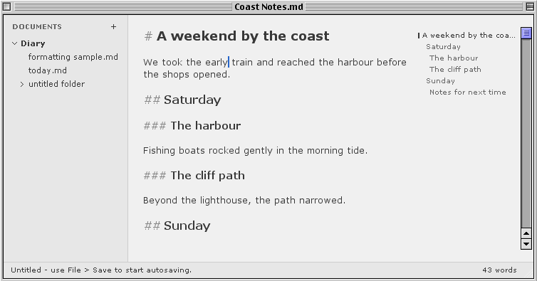

# Linewren

A quiet Markdown and plain-text editor for PowerPC Macs. Linewren pairs a classic
Mac interface with live Markdown styling, a centered writing column, and
folders of ordinary UTF-8 files.



## Get Linewren

| System | Release file | Install |
| --- | --- | --- |
| Mac OS 9 | `Linewren-<version>-Mac-OS-9.zip` | Unzip, then decode `Linewren.bin` with a MacBinary-aware utility on the Mac. |
| Mac OS X 10.4 Tiger (PowerPC) | `Linewren-<version>-PowerPC-Tiger.dmg` | Mount the image and drag Linewren to Applications. |
| Mac OS X 10.5 Leopard (PowerPC) | `Linewren-<version>-PowerPC-Leopard.dmg` | Mount the image and drag Linewren to Applications. |

[GitHub releases](https://github.com/hazy-bits/linewren/releases) will carry these
downloads. The Classic build is exercised on Mac OS 9.2.2. The Carbon build
has been used on PowerPC Tiger. Leopard validation is pending.

## Write and navigate

- Open Markdown or plain text from Finder, the File menu, or an attached folder.
- Use **⌘P** to find a file by name and **⌘F** to find or replace text in the
  current file. Select a word before opening Find to use it as the query.
- Toggle the sidebar with **⌘1** and the clickable heading outline with **⌘2**.
  Focus mode hides both and leaves the writing surface.
- Choose light or dark mode, change the typeface and size, or turn on typewriter
  scrolling. Click the footer count to switch between words and characters.
- Format Markdown from the Edit menu. Linewren groups undo, saves edited files
  safely, and recovers surviving drafts separately after an interrupted session.
- Control-click a sidebar item to rename it, reveal it in Finder, or move it to
  the Trash with confirmation.

## Build and test

Linewren cross-compiles with [Retro68](https://github.com/autc04/Retro68) and Nix.
Linewren grew out of the [Classic Mac App Template](https://github.com/hazy-bits/classic-mac-app-template)
and imports its Nix build helper and guest smoke-test harness.
Configure the [Retro68 binary cache](docs/nix-cache.md) before the first build.

```sh
./scripts/test-local.sh
nix build .#powerpc -o result-classic
nix build .#powerpc-osx -o result-tiger
nix build .#powerpc-osx-leopard -o result-leopard
```

The Classic target produces `Linewren.bin`. The two Carbon targets produce
`Linewren.bin` and `Linewren.img`, an HFS image that preserves the resource fork.
They use the same editor code with platform-specific icon artwork.
Mount the image on the PowerPC Mac, or use `scripts/package-release.sh` on a
modern Mac to make all three release archives.

See [Mac OS 9 testing](docs/testing-mac-os-9.md), [UTM testing](docs/testing-in-utm.md),
and [development notes](docs/development.md) for the guest smoke suites and
source layout. See the [publication checklist](docs/publication.md) for releases
and the website. Rendered preview and HTML export are later milestones.

## Development disclosure

Linewren is a personal project built with substantial help from large language
models (LLMs), including for code, tests, and documentation.

## Support

<a href="https://buymeacoffee.com/hazybits"></a>

## License

Linewren is available under the [MIT License](LICENSE).

## Third-party components

[MD4C](vendor/md4c/LICENSE.md) and the
[Classic Mac App Template](https://github.com/hazy-bits/classic-mac-app-template/blob/main/LICENSE)
use the MIT License. [Bundled fonts](fonts/README.md) include their SIL Open
Font License files.
