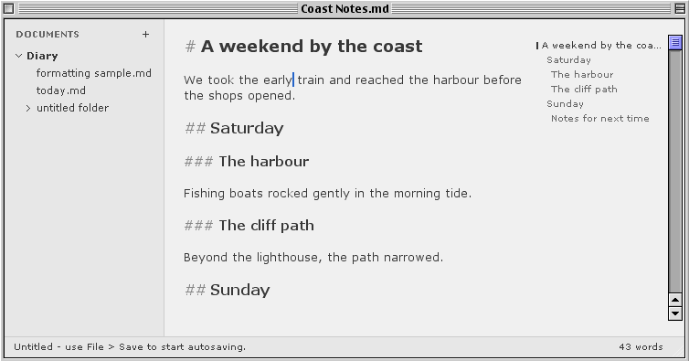

<h1> Linewren</h1>

A quiet, capable Markdown and plain-text editor for PowerPC Macs. Linewren
combines a classic Mac interface with live Markdown styling, fast navigation,
distraction-free writing tools, and spell checking—all while keeping your work
in ordinary text files.

<a href="site/assets/linewren-light.png?raw=true"></a>

## Get Linewren

| System | Release file | Install |
| --- | --- | --- |
| Mac OS 9 | `Linewren-<version>-Mac-OS-9.zip` | Unzip, then decode `Linewren.bin` with a MacBinary-aware utility on the Mac. |
| Mac OS X 10.4 Tiger (PowerPC) | `Linewren-<version>-PowerPC-Tiger.dmg` | Mount the image and drag Linewren to Applications. |
| Mac OS X 10.5 Leopard (PowerPC) | `Linewren-<version>-PowerPC-Leopard.dmg` | Mount the image and drag Linewren to Applications. |

[GitHub releases](https://github.com/hazy-bits/linewren/releases) will carry these
downloads. The Classic build is exercised on Mac OS 9.2.2. The Carbon build
has been used on PowerPC Tiger. Leopard validation is pending.

## What makes Linewren useful

### Find anything without leaving the keyboard

- Press **⌘P** to quickly open any file in an attached folder by name.
- Press **⌘F** to search the current document, move through every match, and
  replace one or all occurrences. A selection becomes the initial query.
- Browse folders in the sidebar, jump through the clickable heading outline,
  and reopen recent files from the File menu.

### Make room for the words

- **Focus Layout** hides the sidebar, outline, and footer for a clean writing
  surface.
- Independent **Line Focus** and **Paragraph Focus** modes dim the surrounding
  text without changing it.
- **Typewriter Scrolling** keeps the current line comfortably positioned.
- Choose a light or dark theme, any installed typeface, and the point size that
  suits the display. Show a word count, character count, or neither.

### Catch mistakes as you write

- Check the whole document on demand or enable **Check Spelling as You Type**.
- Review mistakes one by one, choose a suggestion from the spelling window or
  context menu, and ignore a word for the current document.
- Spelling checks prose while skipping Markdown code and link destinations.
- Mac OS 9 includes US English and Russian dictionaries. Tiger and Leopard use
  the system spelling service, with the language remembered per file.

### Markdown that still looks like Markdown

- Headings, emphasis, links, quotes, lists, code, tables, task lists, and
  strikethrough are styled live in the editor while the source stays visible.
- Apply bold, italic, links, headings, quotes, lists, and tasks from the Edit
  menu. Lists continue and nest naturally as you type.
- Open Markdown or plain text from Finder, the File menu, or an attached folder.
  Files remain ordinary UTF-8 text that other tools can read.

### Built for real files

- Existing files autosave through safe File Manager exchange, with protection
  against overwriting changes made by another application.
- Undo and redo group related edits. Surviving unsaved drafts are recovered
  separately after an interrupted session.
- Control-click a sidebar item to create or rename a Markdown file, reveal it in
  Finder, remove it from the sidebar, or move it to the Trash with confirmation.

## Build and test

Linewren cross-compiles with [Retro68](https://github.com/autc04/Retro68) and Nix.
Linewren grew out of the [Classic Mac App Template](https://github.com/hazy-bits/classic-mac-app-template)
and imports its Nix build helper and guest smoke-test harness.
Configure the [Retro68 binary cache](docs/nix-cache.md) before the first build.

```sh
./scripts/test-local.sh
nix build .#powerpc -o result-classic
nix build .#powerpc-osx -o result-tiger
nix build .#powerpc-osx-leopard -o result-leopard
```

The Classic target produces `Linewren.bin`. The two Carbon targets produce
`Linewren.bin` and `Linewren.img`, an HFS image that preserves the resource fork.
They use the same editor code with platform-specific icon artwork.
Mount the image on the PowerPC Mac, or use `scripts/package-release.sh` on a
modern Mac to make all three release archives.

See [Mac OS 9 testing](docs/testing-mac-os-9.md), [UTM testing](docs/testing-in-utm.md),
and [development notes](docs/development.md) for the guest smoke suites and
source layout. See the [publication checklist](docs/publication.md) for releases
and the website. Rendered preview and HTML export are later milestones.

## Development disclosure

Linewren is a personal project built with substantial help from large language
models (LLMs), including for code, tests, and documentation.

## Support

<a href="https://buymeacoffee.com/hazybits"></a>

## License

Linewren is available under the [MIT License](LICENSE).

## Third-party components

[MD4C](vendor/md4c/LICENSE.md) and the
[Classic Mac App Template](https://github.com/hazy-bits/classic-mac-app-template/blob/main/LICENSE)
use the MIT License.

The Mac OS 9 spell checker uses a modified version of MySpell with
US English and Russian dictionaries.
[MySpell license](vendor/myspell/license.readme) ·
[English dictionary notice](vendor/myspell/README_en_US.txt) ·
[Russian dictionary sources and notices](vendor/dictionaries/ru_RU/README.txt)
